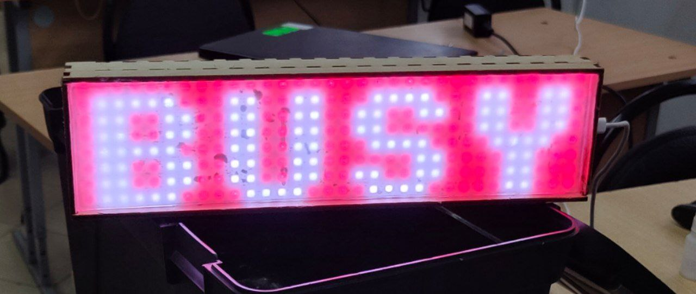
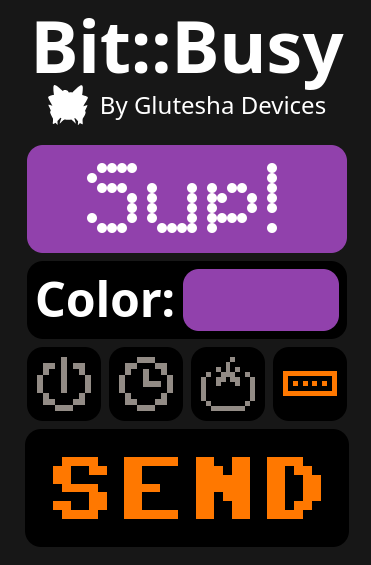
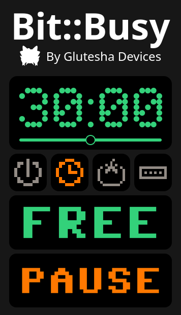

#  Bit:busy     
[](https://lopaka.app/editor/11044/) 

Bitbusy is an LED bar based on an ESP32 microcontroller and WS2812 LEDs that indicates your work status, so your colleagues won't distract you.
### Build and configure
Configure your device in ```src/defines.h```. Then, use ```./build-page.sh``` to build the webpage. Then build and upload the filesystem image in PlatformIO. And only then upload the firmware.
To build the hardware, just connect your LED matrix to a desired port and set it in the defines. You can also use my blueprint from ```blueprint/box.dxf```. 

 

### Technologies
Project written in C++ using PlatformIO and Arduino framework. Images and animations made in [lopaka](https://lopaka.app/editor/11044/). Uses ESPAsyncWebServer and ArduinoJSON for web stuff and Adafruit GFX for graphics. Webpage written in Svelte and Typescript.

---

## Complete Build Guide

### Prerequisites

#### Software Requirements
- **PlatformIO Core** (for ESP32 development)
  ```bash
  # Install via pip
  pip install platformio
  
  # Or via Homebrew (macOS)
  brew install platformio
  ```
- **Node.js** (v18 or later) and npm
- **Git** (for cloning the repository)

#### Hardware Requirements
- **ESP32 Based board** (Seeed XIAO ESP32C3 recommended)
- **WS2812 LED Matrix** (32x8 pixels)
- **USB-C cable** (for programming and power)
- **Laser cutter or a 3D printer** (optional, for enclosure)

### Step 1: Hardware Assembly

#### Basic Connection
1. Connect the LED matrix to the ESP32:
   - **VCC** → **3.3V** (or 5V if your matrix supports it)
   - **GND** → **GND**
   - **DIN** → **GPIO 2** (configurable in `src/defines.h`)

#### Enclosure (Optional)
- Use the provided blueprint: `blueprint/box.dxf`
- Cut the enclosure parts using a laser cutter
- Mount the ESP32 and LED matrix inside
  
### Step 2: Software Setup

#### Clone and Configure
```bash
# Clone the repository
git clone <repository-url>
cd bitbusy

# Configure your device settings
# Edit src/defines.h with your WiFi credentials and preferences:
```

**Edit `src/defines.h`:**
```cpp
#define BRIGHTNESS 20        // LED brightness (0-255)
#define PIN 2               // GPIO pin for LED matrix

#define MATRIX_WIDTH 32     // LED matrix width
#define MATRIX_HEIGHT 8     // LED matrix height

#define SSID "YourWiFiName"     // Your WiFi network name
#define PASSWORD "YourPassword" // Your WiFi password

#define HOSTNAME "bitbusy"      // Device hostname
#define OTA_PASSWORD "bitbusy"  // OTA update password
```

### Step 3: Build and Deploy

#### Build the Web Interface
```bash
# Build the Svelte frontend
./build_page.sh
```

#### Upload to ESP32
```bash
# Build and upload the firmware
pio run -e <Your target board> --target upload

# Upload the filesystem (web interface)
pio run -e <Your target board> --target uploadfs
```

### Step 4: First Boot and Configuration

1. **Power on** the ESP32
2. **Connect to WiFi**: The device will automatically connect using your configured credentials
3. **Access the web interface**: Open a browser and navigate to `http://bitbusy.local` or the IP address shown in the serial monitor

### Step 5: Usage

#### Web Interface
- **Binary Mode**: Simple busy/free toggle
- **Timer Mode**: Set a countdown timer (displays "BUSY" and time left until timer expires)
- **Pomodoro Mode**: Work timer with automatic breaks (timer/5)
- **Running String**: Custom scrolling text with background color

  

#### OTA Updates
The device supports Over-The-Air updates. To update firmware:
```bash
pio run -e <Your target board> --target upload --upload-port <ESP_IP_or_hostname>
```
You can also change the default OTA password in configuration.

### Troubleshooting

#### Common Issues
1. **LED Matrix Not Working**:
   - Check wiring connections
   - Verify PIN number in `src/defines.h`
   - Ensure proper power supply (3.3V or 5V)

2. **WiFi Connection Issues**:
   - Verify SSID and password in `src/defines.h`
   - Check WiFi signal strength
   - Monitor serial output for connection status

3. **Web Interface Not Loading**:
   - Ensure filesystem was uploaded: `pio run <Your target board> --target uploadfs`
   - Check if device is connected to WiFi
   - Try accessing via IP address instead of hostname

4. **Build Errors**:
   - Ensure PlatformIO is properly installed
   - Check that all dependencies are installed
   - Verify Node.js version (v18+)

#### Development Commands
```bash
# Build firmware only
pio run -e <Your target board>

# Monitor serial output
pio device monitor

# Clean build
pio run -e <Your target board> --target clean

# Build frontend only
cd front/bitbusy && npm run build
```

### Customization

#### Adding New Modes
1. Create new screen functions in `src/screens/screens.cpp`
2. Add state handling in `src/state/state.cpp`
3. Update web interface in `front/bitbusy/src/`

#### Changing LED Matrix Size
1. Update `MATRIX_WIDTH` and `MATRIX_HEIGHT` in `src/defines.h`
2. Adjust screen layouts in `src/screens/screens.cpp`
3. Rebuild and upload

#### Modifying Colors and Animations
- Edit color definitions in `src/colors/colors.h`
- Modify animation patterns in `src/screens/screens.cpp`
- Create custom images using https://lopaka.app
